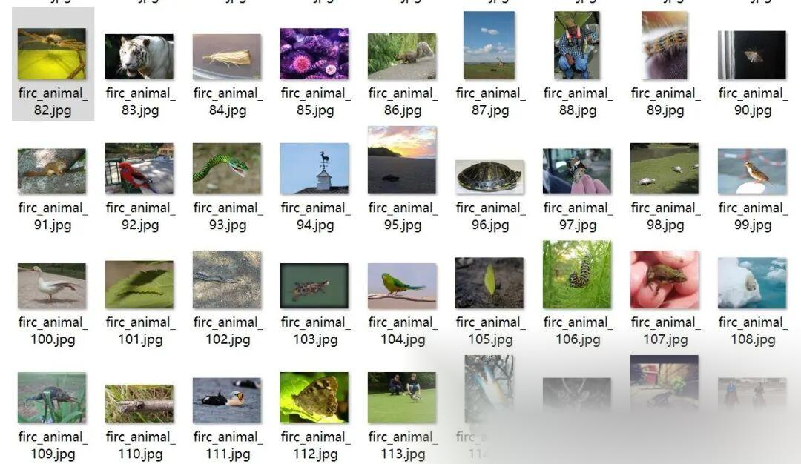
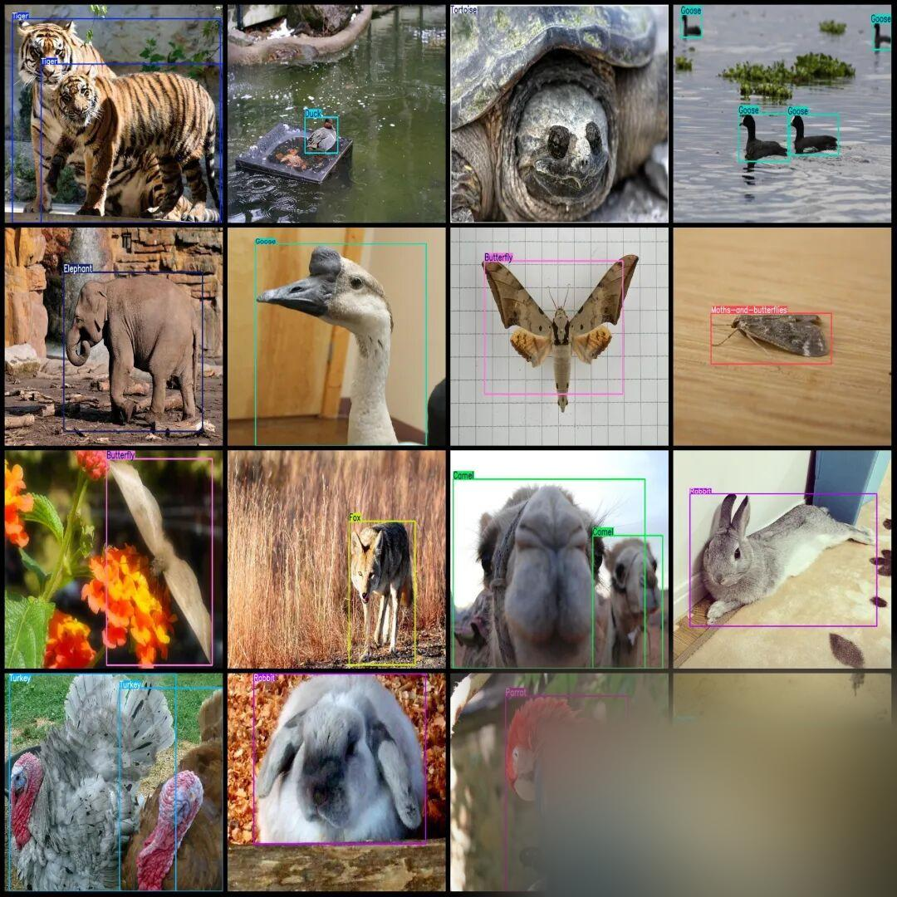

# Super Full Animal Detection Dataset VOC+YOLO format with 27652 images and 80 categories

Dataset format: Pascal VOC format + YOLO format (txt file without split path, only containing jpg images and corresponding VOC format xml files and yolo format txt files)

Number of images (number of jpg files): 27652

Number of annotations (number of xml files): 27652

Number of annotations (number of txt files): 27652

Annotation category count: 80

Label categories: ["Bear", "Brown-bear", "Bull", "Butterfly", "Camel", "Canary", "Caterpillar", "Cattle", "Centipede", "Cheetah", "Chicken", "Crab", "Crocodile", "Deer", "Duck", "Eagle", "Elephant", "Fish", "Fox", "Frog", "Giraffe", "Goat", "Goldfish", "Goose", "Hamster", "Harbor-seal", "Hedgehog", "Hippopotamus", "Horse", "Jaguar", "Jellyfish", "Kangaroo", "Koala", "Ladybug", "Leopard", "Lion", "Lizard", "Lynx", "Magpie", "Monkey", "Moths-and-butterflies", "Mouse", "Mule", "Ostrich", "Otter", "Owl", "Panda", "Parrot", "Penguin", "Pig", "Polar-bear", "Rabbit", "Raccoon", "Raven", "Red-panda", "Rhinoceros", "Scorpion", "Sea-lion", "Sea-turtle", "Seahorse", "Shark", "Sheep", "Shrimp", "Snail", "Snake", "Sparrow", "Spider", "Squid", "Squirrel", "Starfish", "Swan", "Tick", "Tiger", "Tortoise", "Turkey", "Turtle", "Whale", "Woodpecker", "Worm", "Zebra"]

Number of boxes labeled in each category:

Bear frame count = 137

Brown-bear frame count = 158

Bull Frames = 60

Butterfly frame count = 2929

Camel Frame Count = 123

Canary Frames = 145

Caterpillar frame count = 548

Cattle Frames = 276

Centipede frame count = 255

Cheetah frame count = 122

Chicken Frames = 607

Crab Frames = 458

Crocodile frame count = 194

Deer Frames = 656

Duck Frames = 873

Eagle frame count = 951

Elephant Frame Count = 212

Fish Frames = 2511

Fox Frames = 222

Frog Frames = 678

Giraffe frame count = 365

Goat Frames = 335

Goldfish frame count = 244

Goose Frames = 445

Hamster Frames = 140

Harbor-seal frame count = 335

Hedgehog frame count = 135

Hippopotamus frame count = 123

Horse frame count = 663

Jaguar frame count = 143

Jellyfish Frames = 891

Kangaroo frame count = 160

Koala Frames = 83

Ladybug frame count = 453

Leopard frame count = 51

Lion Frames = 317

Lizard frame count = 1502

Lynx frame count = 114

Magpie frame count = 99

Monkey Frames = 1209

Moths-and-butterflies Frame Count = 1491

Mouse Frames = 133

Mule Frames = 106

Ostrich Frames = 239

Otter Frame Count = 115

Owl frame count = 486

Panda Frames = 112

Parrot Frames = 759

Penguin Frames = 1681

Pig Frames = 361

Polar-bear frame count = 304

Rabbit Frames = 345

Raccoon Frame Count = 165

Raven frame count = 145

Red-panda Frames = 85

Rhinoceros frame count = 292

Scorpion frame count = 127

Sea-lion frame count = 70

Sea-turtle frame count = 113

Seahorse frame count = 45

Shark Frames = 400

Sheep Frames = 211

Shrimp frame count = 134

Snail frame count = 519

Snake Frames = 794

Sparrow Frames = 660

Spider frame count = 1119

Squid frame count = 28

Squirrel Frames = 437

Starfish frame count = 323

Swan frame count = 248

Tick Frames = 89

Tiger frame count = 364

Tortoise Frame Count = 542

Turkey Frames = 145

Turtle Frames = 33

Whale frame count = 385

Woodpecker frame count = 211

Worm Frames = 106

Zebra Frames = 266

Total frame count: 34110

Using labelImg:

Annotation rules: Draw a rectangle around the category.

Important Notice: No

Special : This dataset does not guarantee the accuracy or precision of the trained models or weight files. The dataset is provided with accurate and reasonable annotations only.

Image Preview:

Annotation example:

## Payment

Here is a pay link on Stripe ( https://buy.stripe.com/3cs8yP7sY87d0vu9AB ). Please contact me lonlonago@foxmail.com after funding $89, and I will send you a complete data files , thank you!

